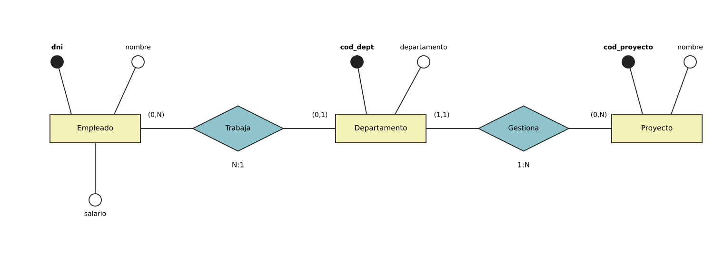
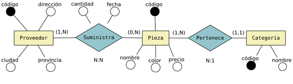
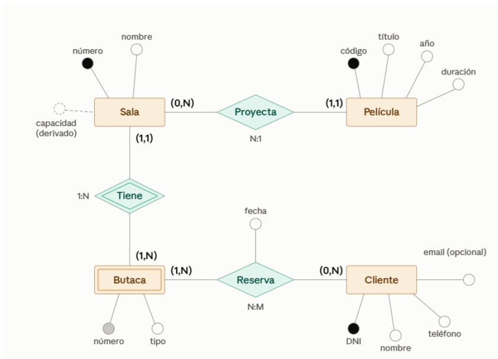

# Tema 8. Ejercicios de SQL (DDL)

> Trabajamos con **MySQL 8**. Cada ejercicio tiene la solución desplegable: intenta hacerlo antes de abrirla.

---

## Ejercicio 1: La tienda: del modelo relacional a SQL

Pasamos a SQL el modelo relacional de la tienda (tema 7):

```
PROVINCIAS (id_provincia, provincia, habitantes)
    PK: id_provincia

CLIENTES (DNI, nombre, id_provincia)
    PK: DNI
    FK: id_provincia → PROVINCIAS(id_provincia)  [NOT NULL]

PRODUCTOS (IdP, nombreP, stock)
    PK: IdP

VENTAS (DNI, IdP, fechaVenta, unds)
    PK: (DNI, IdP)
    FK: DNI → CLIENTES(DNI)
    FK: IdP → PRODUCTOS(IdP)
```


**Condiciones del enunciado:**

- El id_provincia lo genera la base de datos automáticamente.
- No puede haber dos provincias con el mismo nombre.
- El número de habitantes de una provincia es siempre mayor que 0.
- Todos los clientes tienen nombre y provincia. El DNI tiene como máximo 9 caracteres.
- El stock de un producto es 0 si no se indica y nunca es nulo.
- Todos los productos tienen nombre.
- En una venta siempre se indican la fecha y las unidades, y las unidades son mayores que 0.

Se pide: escribe el script SQL que crea la base de datos tienda y sus cuatro tablas, con todas las restricciones. Piensa en el orden en que hay que crear las tablas.


---


### Parte A. Modificar la tienda (ALTER TABLE)

La tienda crece y hay que cambiar la estructura **sin borrar las tablas**. Escribe las sentencias para:

1. Añadir a `CLIENTES` una columna `email` de hasta 80 caracteres.
2. Hacer que el `email` no se pueda repetir entre clientes.
3. Añadir a `PRODUCTOS` una columna `precio` con 2 decimales (hasta 6 cifras en total), que no sea nula y por defecto 0.
4. Añadir un `CHECK` a `PRODUCTOS` para que `precio` no sea negativo, llamándolo `ck_precio`.
5. Ampliar `nombreP` de `PRODUCTOS` a 100 caracteres, manteniendo que no sea nulo.
6. Cambiar el nombre de la columna `nombre` de `CLIENTES` por `nombre_completo`.
7. Borrar la columna `email` de `CLIENTES`.
8. Borrar el `CHECK` `ck_precio`.


---

### Parte B. Borrar con FK: ON DELETE

Partimos de la tienda del ejercicio 1, con estos datos:

```sql
INSERT INTO PROVINCIAS (provincia, habitantes) VALUES ('Jaén', 100000), ('Granada', 200000);
INSERT INTO PRODUCTOS (IdP, nombreP, stock) VALUES ('P01', 'Ratón', 50), ('P02', 'Teclado', 20);
INSERT INTO CLIENTES VALUES ('44444444X', 'Ana', 1), ('55555555H', 'Luis', 2);
INSERT INTO VENTAS VALUES
    ('44444444X', 'P01', '2024-01-10', 1),
    ('44444444X', 'P02', '2024-01-10', 2),
    ('55555555H', 'P01', '2024-01-12', 1);
```

Se ejecuta:

```sql
DELETE FROM CLIENTES WHERE DNI = '44444444X';
```

**Se pide:**

a) ¿Qué ocurre si `VENTAS` está creada **como en el ejercicio 1** (sin `ON DELETE`)?

b) Escribe cómo habría que definir la FK `DNI` de `VENTAS` para que, al borrar un cliente, se borren también sus ventas. ¿Qué filas quedarían en `VENTAS` tras el `DELETE`?

---

## Ejercicio 2: Proyectos

Pasamos a SQL el modelo relacional de una empresa (tema 7):

```
DEPARTAMENTOS (cod_dept, departamento)
    PK: cod_dept

EMPLEADOS (dni, nombre, salario, cod_dept)
    PK: dni
    FK: cod_dept → DEPARTAMENTOS(cod_dept)       [puede ser NULL]

PROYECTOS (cod_proyecto, nombre, cod_dept)
    PK: cod_proyecto
    FK: cod_dept → DEPARTAMENTOS(cod_dept)       [NOT NULL]
```



**Condiciones del enunciado:**

- El cod_dept lo genera la base de datos automáticamente.
- Todo departamento tiene nombre y no puede haber dos con el mismo nombre.
- El DNI tiene como máximo 9 caracteres. Todo empleado tiene nombre.
- El salario de un empleado es 1200 si no se indica, nunca es nulo y siempre es mayor que 0.
- Un empleado puede no tener departamento.
- El código de proyecto tiene como máximo 5 caracteres. Todo proyecto tiene nombre y pertenece a un departamento.

**Se pide:** escribe el script SQL que crea la base de datos empresa y sus tres tablas, con todas las restricciones. Piensa en el orden en que hay que crear las tablas.

---

### Parte A. Modificar la empresa (ALTER TABLE)

La empresa crece y hay que cambiar la estructura **sin borrar las tablas**. Escribe las sentencias para:

1. Añadir a `EMPLEADOS` una columna `email` de hasta 80 caracteres.
2. Hacer que el `email` no se pueda repetir entre empleados.
3. Añadir a `DEPARTAMENTOS` una columna `presupuesto` con 2 decimales (hasta 8 cifras en total), que no sea nula y por defecto 0.
4. Añadir un `CHECK` a `DEPARTAMENTOS` para que `presupuesto` no sea negativo, llamándolo `ck_presupuesto`.
5. Ampliar `nombre` de `EMPLEADOS` a 80 caracteres, manteniendo que no sea nulo.
6. Cambiar el nombre de la columna `departamento` de `DEPARTAMENTOS` por `nombre_dept`.
7. Borrar la columna `email` de `EMPLEADOS`.
8. Borrar el `CHECK` `ck_presupuesto`.

---

### Parte B. Borrar con FK: ON DELETE SET NULL

Partimos de la empresa del ejercicio, con estos datos:

```sql
INSERT INTO DEPARTAMENTOS (departamento) VALUES ('Ventas'), ('Compras');
INSERT INTO EMPLEADOS (dni, nombre, salario, cod_dept) VALUES
    ('11111111A', 'Ana', 1500, 1),
    ('22222222B', 'Luis', 1300, 1),
    ('33333333C', 'Eva', 1400, 2),
    ('44444444D', 'Pau', 1200, NULL);
INSERT INTO PROYECTOS (cod_proyecto, nombre, cod_dept) VALUES ('PR1', 'Web', 2);
```

Se ejecuta:

```sql
DELETE FROM DEPARTAMENTOS WHERE cod_dept = 1;
```

**Se pide:**

a) ¿Qué ocurre si `EMPLEADOS` está creada **como en el ejercicio** (sin `ON DELETE`)?

b) Escribe cómo habría que definir la FK `cod_dept` de `EMPLEADOS` para que, al borrar un departamento, sus empleados **se queden sin departamento** (y no se borren). ¿Cómo quedaría la tabla `EMPLEADOS` tras el `DELETE`?

---

## Ejercicio 3: Proveedores y piezas: del modelo relacional a SQL

Pasamos a SQL el modelo relacional de un almacén de piezas (tema 7):

```
CATEGORIAS (cod_categoria, nombre)
    PK: cod_categoria

PROVEEDORES (cod_proveedor, direccion, ciudad, provincia)
    PK: cod_proveedor

PIEZAS (cod_pieza, nombre, color, precio, cod_categoria)
    PK: cod_pieza
    FK: cod_categoria → CATEGORIAS(cod_categoria)     [NOT NULL]

SUMINISTRA (cod_proveedor, cod_pieza, cantidad, fecha)
    PK: (cod_proveedor, cod_pieza)
    FK: cod_proveedor → PROVEEDORES(cod_proveedor)
    FK: cod_pieza → PIEZAS(cod_pieza)
```



**Condiciones del enunciado:**

- Los códigos son de texto de hasta 5 caracteres (`C1`, `P01`, `A101`…).
- Toda categoría tiene nombre y no puede haber dos con el mismo nombre.
- De un proveedor, la dirección es obligatoria. La ciudad y la provincia pueden quedar vacías.
- Toda pieza tiene nombre y precio (con 2 decimales, hasta 6 cifras en total, nunca negativo). El color puede quedar vacío.
- Toda pieza pertenece a una categoría.
- En un suministro, la cantidad es obligatoria y mayor que 0. Si no se indica la fecha, se usa la fecha de hoy.

**Se pide:** escribe el script SQL que crea la base de datos `almacen` y sus cuatro tablas, con todas las restricciones. Piensa en el orden en que hay que crear las tablas.

---

### Parte A. Modificar el almacén (ALTER TABLE)

El almacén crece y hay que cambiar la estructura **sin borrar las tablas**. Escribe las sentencias para:

1. Añadir a `PROVEEDORES` una columna `telefono` de hasta 9 caracteres.
2. Hacer que el `telefono` no se pueda repetir entre proveedores.
3. Añadir a `PIEZAS` una columna `stock` de tipo entero, que no sea nula y por defecto 0.
4. Añadir un `CHECK` a `PIEZAS` para que `stock` no sea negativo, llamándolo `ck_stock`.
5. Ampliar `nombre` de `PIEZAS` a 100 caracteres, manteniendo que no sea nulo.
6. Cambiar el nombre de la columna `direccion` de `PROVEEDORES` por `domicilio`.
7. Borrar la columna `telefono` de `PROVEEDORES`.
8. Borrar el `CHECK` `ck_stock`.

---

### Parte B. Borrar con FK: ON DELETE

Partimos del almacén del ejercicio, con estos datos:

```sql
INSERT INTO CATEGORIAS VALUES ('C1', 'Periféricos'), ('C2', 'Pantallas');
INSERT INTO PROVEEDORES (cod_proveedor, direccion) VALUES ('P01', 'C/ Mayor 1'), ('P02', 'C/ Sol 5');
INSERT INTO PIEZAS (cod_pieza, nombre, precio, cod_categoria) VALUES
    ('A101', 'Ratón', 9.99, 'C1'),
    ('A102', 'Monitor', 129.90, 'C2');
INSERT INTO SUMINISTRA (cod_proveedor, cod_pieza, cantidad, fecha) VALUES
    ('P01', 'A101', 20, '2025-03-01'),
    ('P01', 'A102', 5, '2025-03-01'),
    ('P02', 'A101', 40, '2025-03-05');
```

Se ejecuta:

```sql
DELETE FROM PROVEEDORES WHERE cod_proveedor = 'P01';
```

**Se pide:**

a) ¿Qué ocurre si `SUMINISTRA` está creada **como en el ejercicio** (sin `ON DELETE`)?

b) Escribe cómo habría que definir la FK `cod_proveedor` de `SUMINISTRA` para que, al borrar un proveedor, se borren también sus suministros. ¿Qué filas quedarían en `SUMINISTRA` tras el `DELETE`?

---


## Ejercicio 4: El cine: del modelo relacional a SQL

Pasamos primero a modelo relacional de un cine (tema 7) antes de pasarlo a SQL:



**Condiciones del enunciado:**

- El `num_sala` es un número entero que se asigna a mano. Toda sala tiene nombre y no puede haber dos con el mismo nombre.
- El código de película tiene como máximo 5 caracteres. Toda película tiene título, año y duración, y la duración (en minutos) es siempre mayor que 0.
- Una sala puede no tener película asignada. **Si se borra una película, sus salas no se borran: se quedan sin película.**
- El número de butaca es un entero que solo se repite entre salas distintas. El tipo de butaca tiene como máximo 10 caracteres, es obligatorio, solo puede ser `'normal'` o `'vip'`, y vale `'normal'` si no se indica. **Si se borra una sala, se borran también sus butacas.**
- El DNI tiene como máximo 9 caracteres. Todo cliente tiene nombre y teléfono (9 caracteres), y el teléfono no se puede repetir entre clientes. El email es opcional.
- En una reserva, el cliente, la butaca y la fecha son siempre obligatorios. Un cliente o una butaca con reservas no se pueden borrar.

**Se pide:** escribe el script SQL que crea la base de datos `cine` y sus cinco tablas, con todas las restricciones. Piensa en el orden en que hay que crear las tablas.

---

### Parte A. Modificar el cine (ALTER TABLE)

El cine crece y hay que cambiar la estructura **sin borrar las tablas**. Escribe las sentencias para:

1. Añadir a `PELICULAS` una columna `genero` de hasta 20 caracteres.
2. Añadir a `PELICULAS` una columna `puntuacion` con 1 decimal (hasta 3 cifras en total), que no sea nula y por defecto 0.
3. Añadir a `SALAS` una columna `planta` de tipo entero, que no sea nula y por defecto 0.
4. Ampliar `titulo` de `PELICULAS` a 150 caracteres, manteniendo que no sea nulo.
5. Cambiar el nombre de la columna `nombre` de `CLIENTES` por `nombre_completo`.
6. Borrar la columna `genero` de `PELICULAS`.

---

### Parte B. Borrar con FK

Partimos del cine del ejercicio, con estos datos:

```sql
INSERT INTO PELICULAS (cod_pelicula, titulo, anio, duracion) VALUES
    ('F01', 'Dune', 2021, 155),
    ('F02', 'Up', 2009, 96);
INSERT INTO SALAS (num_sala, nombre, cod_pelicula) VALUES
    (1, 'Sala Oro', 'F01'),
    (2, 'Sala Plata', 'F02'),
    (3, 'Sala Bronce', 'F01');
INSERT INTO BUTACAS (num_sala, num_butaca, tipo) VALUES
    (1, 1, 'normal'),
    (1, 2, 'vip'),
    (2, 1, 'normal');
INSERT INTO CLIENTES (dni, nombre, telefono) VALUES ('11111111A', 'Ana', '600111222');
INSERT INTO RESERVAS (num_sala, num_butaca, dni, fecha) VALUES (2, 1, '11111111A', '2025-05-10');
```

Se ejecutan **en este orden**:

```sql
-- 1
DELETE FROM PELICULAS WHERE cod_pelicula = 'F01';
-- 2
DELETE FROM SALAS WHERE num_sala = 1;
-- 3
DELETE FROM SALAS WHERE num_sala = 2;
-- 4
DELETE FROM CLIENTES WHERE dni = '11111111A';
```

**Se pide:**

a) Indica para cada sentencia si **funciona** o **da error**, y qué ocurre con las demás tablas.

b) ¿Qué filas quedan al final en `SALAS` y en `BUTACAS`?
